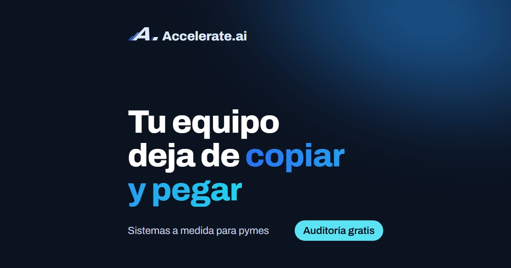
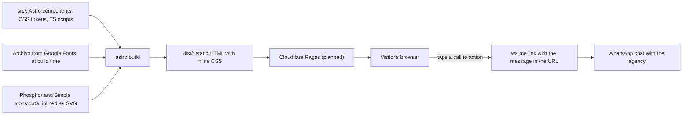

# accelerate-ai-web

One-page Astro site for Accelerate.ai, an agency that builds custom software for small businesses.

[](LICENSE) [](package.json)

**Status:** in development, not published. There is no live URL yet, and the domain in
`astro.config.mjs` is a placeholder.

<!-- TODO: screenshots after tanda 3: the landing's first screen at 360 px (phone) and at 1280 px, from `npm run capturas`, in docs/img/. Until then, the Open Graph card below. -->


## The problem

The owners of small businesses in Argentina keep their cash, orders and stock in notebooks,
spreadsheets and chat threads. They are not technical, and the agency sells them custom systems
that replace that. The site has one job: get an owner to start a conversation. It has no contact
form and no backend. Every call to action opens WhatsApp with the message already typed.

## What it does

The page is in Argentine Spanish, since that is the market. In order:

- **Hero** (`#inicio`): the headline, the WhatsApp button and an animated dashboard of a business
  with several systems.
- **Industries**: a slow ticker of 19 lines of business (`rubros`) where the same tasks repeat
  every day.
- **What we solve** (`#resolvemos`): three pains in the owner's words, with a switch between
  "Hoy" (today) and "Con un sistema" (with a system) that swaps each pain for its fix.
- **Custom systems** (`#sistemas`): three working mockups (a work-order board, a daily cash close
  and a stock list with minimums), then a wall of 8 system types. Mock data is labeled
  "Datos de ejemplo" (sample data).
- **A first project** (`#trabajo`): a demo of `quiniela-system`, a separate cash-control app,
  shown as three phone screens, a verbatim exchange with its assistant and a simulated month. The
  scene carries the seal "Demo con datos simulados".
- **How we work** (`#proceso`): the process as a timeline.
- **Your time** (`#tiempo`): a calculator. Pick a task, hours per week (1 to 20) and people
  (1 to 10); the result is hours x people x 4 per month. With 5 hours and 2 people it shows 40,
  and the button opens WhatsApp with *"Hola, vi la web. Se me van unas 40 horas por mes haciendo
  la caja."*
- **FAQ** (`#preguntas`), the closing call to action and the footer. A second page, `/legal`,
  holds privacy and terms, and there is a custom 404.

## How it works



A visit, from a phone: the browser gets one HTML file with the CSS inline and loads one
self-hosted font file. Sections fade in through CSS scroll-driven animations. Small scripts
handle the parts CSS cannot: dragging the switch and the mockups, the odometer in the
calculator, and the phone scene. When the owner taps a button, `whatsappUrl()` in
`src/config.ts` has already put the message in the link, so nothing goes through a server.

Stack: Astro 7 (`^7.3.4`) with static output, TypeScript 6, hand-written CSS on the brand's
design tokens, Phosphor icons through Iconify, Archivo as the only font. The one runtime
dependency is `astro`. Playwright 1.63 and axe-core are dev dependencies. Measured on
2026-10-12: `dist/index.html` is 360,529 bytes (65,997 gzipped) and the 8 JavaScript files add
up to 16,410 bytes (6,138 gzipped). More in [the architecture notes](docs/ARCHITECTURE.md).

## Engineering decisions

- **The final state is the base state, and scroll animations are CSS.** Every element is
  written as it should end up, and `animation-timeline: view()` only adds the way in. Without
  JavaScript, without browser support, or with `prefers-reduced-motion: reduce`, the whole page
  is visible. Instead of hiding elements until an `IntersectionObserver` reveals them. Cost: a
  broken timeline fails silently. Two causes came up (the CSS minifier and `overflow: hidden`),
  so `scripts/capturas.mjs` lists every animation that asks for a timeline and has none. See
  [ADR 0001](docs/adr/0001-scroll-animations-final-state-base.md).
- **CSS minified with esbuild.** Astro's default minifier (Lightning CSS) merged
  `animation-timeline` into the `animation` shorthand, and Chrome dropped the declaration, which
  stopped every scroll animation (comment in `astro.config.mjs`). Cost: one override to keep.
- **CSS inline in the HTML** (`inlineStylesheets: 'always'`), instead of a cached stylesheet.
  The site is a landing plus a legal page and most visits see one page, so there is little to
  cache across pages. Cost: a strict Content-Security-Policy would block the inline CSS and
  scripts, so `public/_headers` sets only `frame-ancestors 'none'`, and the HTML is 352 KiB
  before compression.
- **No backend: the contact is a `wa.me` link with a per-button message.** Instead of a form
  and a server. Each button carries its own text, such as the calculator's hours. Cost: the site
  stores nothing and has no analytics (nothing in `src/` sends data anywhere), so it cannot say
  which button converted.
- **A Playwright suite as the acceptance gate, with real 200 % text.** The page has no business
  logic to unit test. The risks are layout, accessibility and motion, so `npm run capturas`
  measures them. The 200 % case uses Chrome's own text size (CDP `Page.setFontSizes`), which
  scales `rem` and `em` media queries, and a bare `font-size: 200%` on `<html>` does not.
  Cost: the checks use class names as selectors, so renaming a class means editing a script.
- **The Open Graph image is composed in code.** `src/pages/[plantilla].astro` renders it with
  the real font, tokens and logo, and `npm run og` screenshots it with Playwright into
  `public/og.jpg`. Instead of exporting a file from a design tool. Cost: a manual run when the
  headline or logo changes, and it needs Chromium. The script fails if the JPEG passes 300 KB,
  because WhatsApp may skip larger previews. Today it is 52,643 bytes.

## Getting started

Needs Node.js 22.12 or later (`engines` in `package.json`) and internet access during the
build, because the font is downloaded then. There are no environment variables and no
credentials.

```bash
npm ci
npm run dev
```

Open `http://localhost:4321`. You will see the landing with its animated dashboard. If the port
is taken, Astro uses the next free one and prints the URL. There is no seed data: the numbers in
the mockups are written in the components.

> [!NOTE]
> The call-to-action buttons open a chat with the agency's real WhatsApp number (set in
> `src/config.ts`). The build also prints a warning about the placeholder domain; that is
> expected.

| Script | What it does |
| --- | --- |
| `npm run dev` | Dev server. |
| `npm run build` | Static site into `dist/`. |
| `npm run preview` | Serves `dist/` locally. |
| `npm run check` | `astro check`: types for scripts and component props. |
| `npm run capturas` | The full check suite (see Tests). `capturas` means "captures": it also saves screenshots. |
| `npm run og` | Regenerates `public/og.jpg`. |
| `npm run iconos` | Regenerates `public/favicon.png` and `public/apple-touch-icon.png` from `public/favicon.svg`. |

## Tests

```bash
npx playwright install chromium firefox webkit
npm run capturas
```

The install is a one-time step. The suite needs those three browsers, no Docker and no
credentials. It runs `astro check` and `astro build`, then drives the built site with
Playwright, and exits with an error if any check fails. Screenshots go to `capturas/`
(gitignored). What it covers, with the parts that cost the most if they break first:

- The WhatsApp message and the total for five calculator cases, at 360, 768 and 1280 px.
- Open Graph tags and image, and the sitemap, the 404 and the headers in `public/_headers`.
- Layout: no horizontal scroll, 44 px touch targets, internal links that resolve.
- Accessibility: axe-core with no serious or critical violations at 360 and 1280 px, text at
  200 % at four widths, forced colors.
- Motion: scroll animations that have their timeline, reduced motion, and `#trabajo` and the
  404 with JavaScript off.
- WebKit and Firefox, compared against Chromium.

Last full run recorded on 2026-10-12: 247 checks passed and 0 failed. `npm run check` reports
0 errors, 0 warnings and 0 hints over 57 files, run again for this README. The suite is split
by script in [the architecture notes](docs/ARCHITECTURE.md#check-suite).

## Deployment

Not deployed. The plan is Cloudflare Pages with `npm run build` as the build command and `dist/`
as the output. `public/_headers` is ready for it:

- `/_astro/*` is cached for a year as immutable (`max-age=31536000`), since those file names
  carry a hash.
- Every page gets `X-Content-Type-Options: nosniff`, `Referrer-Policy:
  strict-origin-when-cross-origin`, a `Permissions-Policy` that turns off camera, microphone,
  geolocation, payment, USB and topics, and `frame-ancestors 'none'` with `X-Frame-Options: DENY`.

`capturas-sitio.mjs` checks that these headers reach `dist/` and that `404.html` exists. Without
it, Cloudflare Pages serves the home page with a 200 on any route.

## Limitations and next steps

- **Not published.** Hosting is not connected and the domain is a placeholder
  (`accelerate-ai.example`). Until it changes, the canonical link and the Open Graph URLs point
  to it and link previews will not work. `/legal` still has a `[MAIL]` placeholder in
  `src/components/legal/Privacidad.astro`.
- **`#trabajo` uses placeholder images.** The three phone screens are files labeled "Imagen de
  reemplazo" in `src/assets/trabajo/`, to be replaced with real screenshots of the app with test
  data.
  <!-- TODO: screenshots after tanda 3: add real captures of #trabajo here once they replace the placeholders (docs/img/, under 1 MB each) -->
- **No CI.** There is no `.github/` folder, so the suite only runs on a developer's machine.
- **Known layout bugs at 200 % text** that the suite does not catch: in `MockStock` at 1280 px,
  product names overlap the bar, and in `MockCaja` the "Cierra" seal icon shrinks to a few pixels.
  They were found in a design review on 2026-10-12.
- **High contrast is emulated** with Playwright's `forcedColors`, not tested on Windows.
- **Some components are long**: `MockPanel` is 1,230 lines, `ComoTrabajamos` 962, `MockOrdenes`
  728. Each mixes markup, styles and its script. I would split them first.
- **Spanish only**, with `lang="es-AR"`.

## License

[MIT](LICENSE). It covers the source code only. The Accelerate.ai name and logo, the images in
`src/assets/identidad/` and in `public/` (`og.jpg` and the favicons), and the texts of the site
are not covered: all rights reserved.
