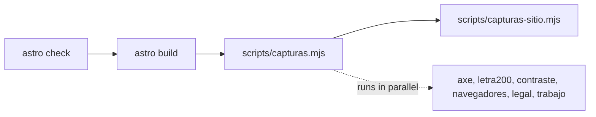

# Architecture

Notes on how the site is put together and how its checks are organized. The overview and the
setup steps are in the [README](../README.md).

## Build output

`npm run build` produces three pages plus two generated files (checked on 2026-10-12):

| Output | Source | Notes |
| --- | --- | --- |
| `/` | `src/pages/index.astro` | The landing. Sections are composed in this file, in page order. |
| `/legal/` | `src/pages/legal.astro` | Privacy and terms. Same header and footer as the landing. |
| `/404.html` | `src/pages/404.astro` | Marked `noindex`, no canonical, left out of the sitemap. |
| `/robots.txt`, `/sitemap.xml` | `src/pages/robots.txt.ts`, `src/pages/sitemap.xml.ts` | Built from `site` in `astro.config.mjs`. The sitemap lists the `.astro` files in `src/pages/` except the 404 and dynamic routes. |

`src/pages/[plantilla].astro` is the Open Graph image template. `getStaticPaths()` returns a
route only when `OG_PLANTILLA` is set, which `scripts/og.mjs` does. A normal build does not
include it.

Size of the build, measured on 2026-10-12 with `npm run build`, `wc -c` and `gzip -c` (default
level; the host may compress differently):

| File | Bytes | Gzipped |
| --- | --- | --- |
| `dist/index.html` (CSS inline) | 360,529 | 65,997 |
| `dist/legal/index.html` | 98,705 | 18,762 |
| `dist/404.html` | 90,888 | 15,513 |
| 8 JavaScript files in `dist/_astro/` | 16,410 | 6,138 |
| Archivo font, one `woff2` file | 34,940 | not measured |

The home page has no `<link rel="stylesheet">`: Astro inlines the CSS (`build.inlineStylesheets:
'always'`). It contains 20 `wa.me` links.

## Source layout

| Path | What lives there |
| --- | --- |
| `src/components/secciones/` | One component per page section (`Portada`, `Rubros`, `QueResolvemos`, `SistemasAMedida`, `PrimerTrabajo`, `ComoTrabajamos`, `TuTiempo`, `PreguntasFrecuentes`, `Cierre`). |
| `src/components/mocks/` | The animated product mockups: `MockPanel` (hero dashboard), `MockOrdenes`, `MockCaja`, `MockStock`. |
| `src/components/trabajo/` | The pieces of `#trabajo`: phones, conversation, selector, the simulated month. |
| `src/components/tiempo/` | The calculator in `#tiempo`: controls and the odometer result, each with its `.ts`. |
| `src/components/legal/` | Text blocks of `/legal`. |
| `src/components/` (top level) | Header (`Encabezado`), footer (`Pie`), `Logo`, `Icono`, `Glow`, `BotonWhatsApp`. |
| `src/layouts/Base.astro` | `<head>`: font preload, canonical, Open Graph tags. |
| `src/styles/` | `global.css` (layout helpers and the motion classes) and `tokens/` (colors, type, effects). |
| `src/scripts/` | Client scripts shared by components (`contar.ts`, `trabajo-escenario.ts`, `trabajo-mes.ts`). |
| `src/config.ts` | `whatsappUrl(mensaje)`: builds the `wa.me` link with the message URL-encoded. |
| `public/` | Favicons, `og.jpg`, `_headers`. |
| `scripts/` | `og.mjs`, `iconos.mjs`, the `capturas*.mjs` checks and `setup-worktree.ps1`. |

Build-time work:

- `Icono.astro` reads icon data from `@iconify-json/ph` (Phosphor) and `@iconify-json/simple-icons`
  and writes inline SVG, so the browser downloads no icon font or CDN script. A name that does not
  exist throws and fails the build.
- `Celular.astro` renders the `#trabajo` screenshots with `<Picture>` as AVIF and WebP at
  216, 324, 432 and 648 px wide.
- Archivo is downloaded from Google Fonts during the build and served from the site's own origin
  (`fonts` in `astro.config.mjs`, `` in `Base.astro`).

## Motion model

See [ADR 0001](adr/0001-scroll-animations-final-state-base.md). The classes in `global.css`:

| Class | With motion | With `prefers-reduced-motion: reduce` |
| --- | --- | --- |
| `.entrada` | Slides up on load, staggered by `--orden`. | 0.3 s fade. |
| `.revelar` | Slides up as it enters the viewport (`view()` timeline). | Fade over the first half of the entry. |
| `.fundir` | Has its own entry inside its component. | Same fade as `.revelar`. |

## Check suite

`npm run capturas` runs `astro check && astro build && node scripts/capturas.mjs && node
scripts/capturas-sitio.mjs`. Screenshots go to `capturas/`, which is gitignored.

| Script | What it checks |
| --- | --- |
| `capturas.mjs` | At 360, 768 and 1280 px: no horizontal scroll, buttons inside the margin, 44 px touch targets, internal anchors resolve, scroll animations have a timeline, the toggle and the menu work, the `#tiempo` calculator (total, button message, `aria-valuetext`, live announcement), text at 150 %, Open Graph tags and image. |
| `capturas-axe.mjs` | axe-core at 360 and 1280 px with reduced motion; fails on `serious` or `critical` violations. Two regions are excluded and the reason is in the file. |
| `capturas-letra200.mjs` | Browser text at 200 % through CDP `Page.setFontSizes` at 360 and 320 px, plus a 200 % `font-size` on `<html>` at 1280 and 1100 px. Walks the page and flags text that overflows. |
| `capturas-contraste.mjs` | `forcedColors: 'active'` at 360 px (Windows high contrast, emulated): only the chosen toggle option has an outline. |
| `capturas-navegadores.mjs` | WebKit and Firefox at 360 and 1280 px, with and without reduced motion: no console errors, no horizontal scroll, opacity compared with Chromium. |
| `capturas-legal.mjs` | `/legal` at 360 and 1280 px, with and without reduced motion. |
| `capturas-trabajo.mjs` | `#trabajo` at 360, 768, 1024 and 1280 px, with motion, with reduced motion and with JavaScript off. |
| `capturas-sitio.mjs` | The 404 page (status 404, one `h1`, no console errors), the header CTA state, the mobile menu anchors (768 px at 200 % and 100 %, 360 px), the stock and cash-close mockups at 200 % text (no overlaps, seal icon size, amounts on one line), `404.html` in the build, the sitemap, and the headers in `public/_headers`. |

Last full run recorded on 2026-10-12: 256 checks passed, 0 failed (218 from `capturas.mjs` and
the modules it calls, 38 from `capturas-sitio.mjs`). The checks use class names and ids as
selectors (`.capsula__cta`, `#tiempo`), so renaming one in a component means updating the
script.
